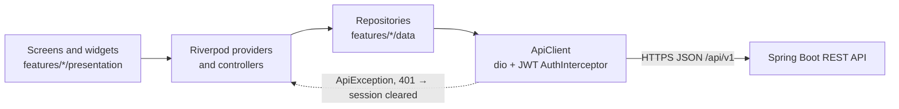
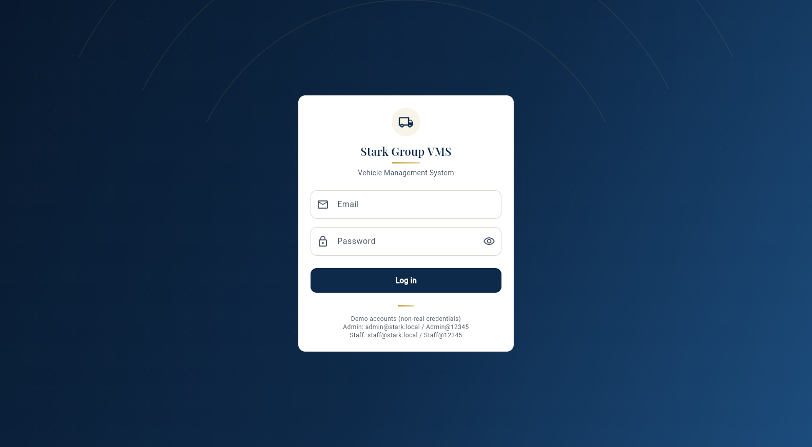
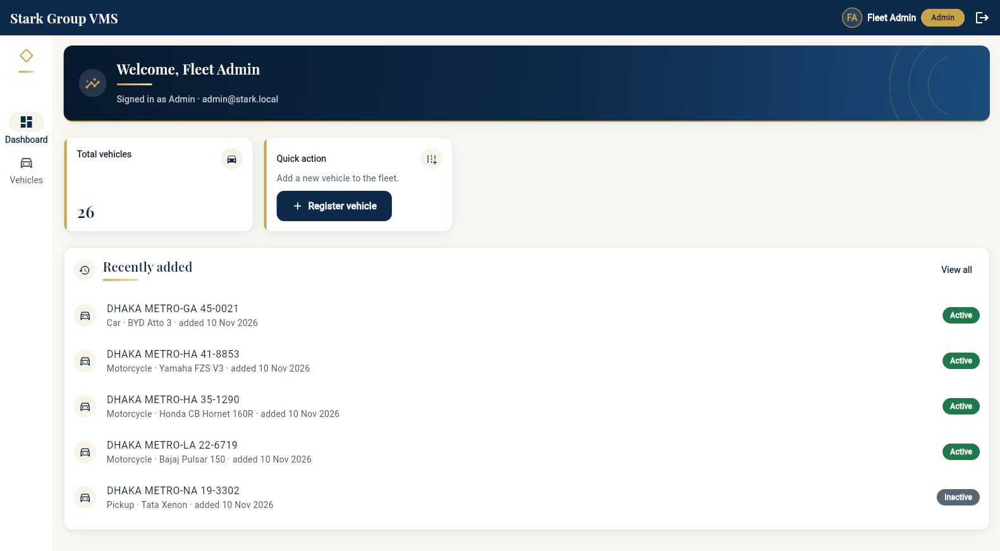
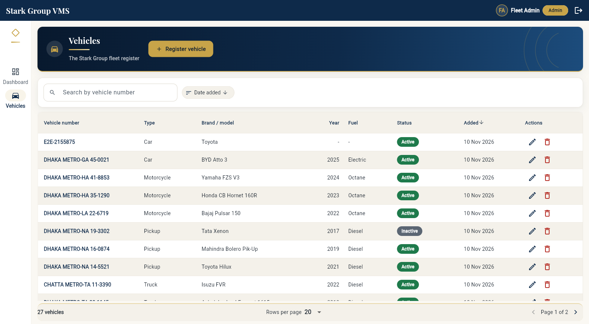
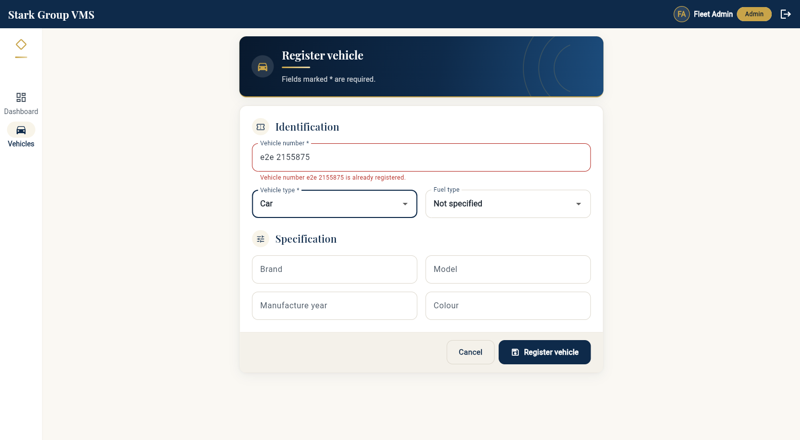

# Stark Group VMS — Frontend (Flutter Web)

> ### Stark Group VMS — one project, two repositories
>
> The fleet management system is split the way it is deployed, as the course guideline (Section 9)
> asks. To see or run the whole thing you need both; to simply *use* it, open the live site.
>
> | Repository | What is in it |
> |---|---|
> | [`stark-vms-backend`](https://github.com/AvishekBis/stark-vms-backend) | Spring Boot 3.5 / Java 21 REST API, PostgreSQL, Flyway, JWT |
> | [`stark-vms-frontend`](https://github.com/AvishekBis/stark-vms-frontend) | Flutter Web client, Riverpod, go_router **(you are here)** |
>
> **Live site:** <https://stark-vms-avishek.netlify.app> · **API:** <https://stark-vms-backend-i2i2.onrender.com/api/v1> · **API docs:** <https://stark-vms-backend-i2i2.onrender.com/swagger-ui.html>
>
> Demo logins and the whole feature list are further down this page. The API is on Render's free
> tier and sleeps when idle, so the first request can take up to a minute.

Vehicle Management System for the Stark Group fleet: login, vehicle list, register / edit /
delete vehicles with duplicate-number protection. **Release v1.0 (Assignment 1)**, plus the
**v1.1 hardening**: the login screen shows the 429 of login throttling
([ADR 0022](https://github.com/AvishekBis/stark-vms-backend/blob/main/docs/adr/0022-login-throttling.md)) and the vehicle edit form handles optimistic
locking (`version`, 409 `stale-version`, [ADR 0023](https://github.com/AvishekBis/stark-vms-backend/blob/main/docs/adr/0023-optimistic-locking.md));
contract section 6.
All data comes from the Spring Boot API ([`stark-vms-backend`](https://github.com/AvishekBis/stark-vms-backend/tree/main)) —
there is no mock or hard-coded vehicle data in `lib/` (FR-V06).

## Live

| | URL |
|---|---|
| Frontend (Netlify) | <https://stark-vms-avishek.netlify.app> |
| Backend API (Render) | <https://stark-vms-backend-i2i2.onrender.com/api/v1> |
| API docs (Swagger UI) | <https://stark-vms-backend-i2i2.onrender.com/swagger-ui.html> |

Demo accounts — throw-away credentials, not used anywhere else. The live site uses the second pair; running
locally bootstraps the first:

| Role | Email | Password (local) | Password (live site) |
|---|---|---|---|
| ADMIN | `admin@stark.local` | `Admin@12345` | `Wildstone99@b` |
| STAFF | `staff@stark.local` | `Staff@12345` | `Wildstone98@b` |

Signing in as STAFF shows the role rules: deleting a vehicle is ADMIN-only and the API answers 403.

> The free Render instance sleeps when idle. The first request can take up to a minute; the app
> shows **"Connecting to server…"** after 3 seconds. To give it a head start, the app sends a
> fire-and-forget `GET /actuator/health` as soon as it loads, so the backend wakes while the user
> types the login details. Open the site once before a demo.

## Tech stack (exact versions, pinned in `pubspec.yaml`)

| Area | Package | Version |
|---|---|---|
| SDK | Flutter / Dart | 3.47.7 / 3.13.5 |
| State management | `flutter_riverpod` | 2.6.1 |
| Routing | `go_router` | 18.1.2 |
| HTTP | `dio` | 5.11.1 |
| Session storage | `shared_preferences` | 2.5.6 |
| Date/number formatting | `intl` | 0.20.3 |
| Lints (dev) | `flutter_lints` | 6.0.0 |
| Tests (dev) | `flutter_test`, `integration_test`, `flutter_driver` | SDK |

## Architecture

The reasons for this architecture (bounded contexts, data ownership, layering, state management, security, NFRs) are recorded as Architecture Decision Records in [`../docs/adr/`](https://github.com/AvishekBis/stark-vms-backend/blob/main/docs/adr/README.md).



Screens only watch providers and forward user actions; they never call a repository or build a
request themselves. Providers and controllers hold the state and the rules (validation, which
caches to refresh), and repositories turn domain objects into REST calls through the single
`ApiClient`. The `ApiClient` attaches the bearer token, applies the timeouts and converts every
failure into an `ApiException`, so error handling is the same on every screen.

Feature-first structure (guideline section 9.2). Widgets only render state and forward user
actions; rules live in controllers, repositories and validators.

```
lib/
├── main.dart, bootstrap.dart, app.dart   entry point, ProviderScope, MaterialApp.router
├── core/
│   ├── config/      AppConfig (API_BASE_URL via --dart-define, timeouts, debounce)
│   ├── network/     ApiClient (Dio + AuthInterceptor), ApiException (Problem Details,
│   │                isTooManyRequests, isStaleVersion),
│   │                PageResponse<T>, SlowRequestMonitor, session signals
│   ├── router/      go_router with auth redirect guard (refreshListenable)
│   ├── storage/     SharedPreferences provider
│   ├── theme/       AppTheme (one ThemeData), AppPalette, AppDecorations, StatusColors
│   │                extension, spacing (design language: ADR 0025)
│   └── utils/       validators, debouncer, clock, formatters
├── shared/widgets/  AppShell, StatusBadge, AsyncValueView/StateViews, ConfirmDialog,
│                    PaginationBar, ConnectingBanner, SplashScreen, AppFeedback,
│                    StaleVersionDialog (v1.1), DataTableFrame, LabeledValue,
│                    BannerActions, brand.dart (PageHeader, SectionHeading,
│                    StatPlate, IconPlate, Ornament)
└── features/
    ├── auth/        data: User, LoginResponse, AuthSession, AuthRepository, SessionStorage
    │                presentation: AuthController, LoginController, LoginScreen
    ├── vehicles/    data: Vehicle, VehicleInput, enums, VehicleQuery, VehicleRepository
    │                presentation: list / form / detail screens, providers, form controller
    └── dashboard/   presentation: DashboardScreen + providers
```

Request flow: screen → Riverpod provider/controller → repository → `ApiClient` →
`/api/v1/...`. The `ApiClient` adds `Authorization: Bearer <token>`, converts every failure
into an `ApiException` (RFC 9457 Problem Details: `status`, `title`, `detail`,
`errors[] → fieldErrors`), maps timeouts/offline to friendly messages, and broadcasts
**401 on any request except login** → the session is cleared → the router sends the user to
`/login` with "Your session has expired".

Ready for v2.0: `PageResponse<T>` and the Problem Details parser are shared in `core/`;
`VehicleQuery` takes `status`/`type` filters without changing callers; `StatusBadge` is generic
(document expiry badges reuse it); a `Clock` provider makes time-based logic testable;
the dashboard providers are the only place to swap for `GET /dashboard/summary`.

## Look and feel

The navy-and-gold design is recorded in
[ADR 0025](https://github.com/AvishekBis/stark-vms-backend/blob/main/docs/adr/0025-visual-identity-navy-and-gold.md) (why, the accessibility rule for
gold, alternatives, costs). It is the same design as Assignment 2, and these four files are
byte-identical in both projects; widgets take colours and decoration from them and write no
colour values of their own:

| File | Holds |
|---|---|
| `lib/core/theme/app_palette.dart` | Every colour value (navy, gold, `goldInk`, cream background, status hues) |
| `lib/core/theme/app_decorations.dart` | Gradients, shadows, cards, `accentCard`, banner, icon plate, gold rule |
| `lib/core/theme/app_theme.dart` | The one `ThemeData` (serif headings, buttons, inputs, dialogs, tables, rail) |
| `lib/shared/widgets/brand.dart` | `PageHeader`, `SectionHeading`, `StatPlate`, `IconPlate`, `Ornament` and the other shared brand widgets |

Headings and figures use **Playfair Display** (Medium, SemiBold, Bold), bundled in
`assets/fonts/` and declared in `pubspec.yaml`; it is licensed under the SIL Open Font License
1.1 (`assets/fonts/OFL.txt`). Nothing is fetched at runtime.

## Run locally

Prerequisites: Flutter 3.47.7, Chrome, and the backend running on `http://localhost:8080`
(see the backend README). The backend must allow the dev origin, e.g.
`CORS_ALLOWED_ORIGINS=http://localhost:5000`.

```bash
flutter pub get
flutter run -d chrome --web-port 5000 --dart-define=API_BASE_URL=http://localhost:8080/api/v1
```

| `--dart-define` | Default | Purpose |
|---|---|---|
| `API_BASE_URL` | none (required) | API base URL incl. `/api/v1`. There is no hard-coded fallback: a build without it shows an "API address not configured" screen |
| `SHOW_DEMO_CREDENTIALS` | `true` in debug / profile, `false` in release | Show the demo account hint on the login screen. Pass `true` explicitly for a demo release build; production builds should leave it off |

## Build and deploy to Netlify

```bash
flutter build web --release --dart-define=API_BASE_URL=https://stark-vms-backend-i2i2.onrender.com/api/v1
# Course demo only: also show the demo account hint on the login screen.
#   --dart-define=SHOW_DEMO_CREDENTIALS=true
```

1. Deploy the `build/web` folder: drag-and-drop in the Netlify UI, or
   `npx netlify-cli deploy --prod --dir=build/web`.
2. SPA routing: `web/_redirects` (`/*  /index.html  200`) is copied into `build/web`, and
   `netlify.toml` contains the same rule, so refreshing a deep link such as `/vehicles/12` works.
   `web/_headers` and `netlify.toml` also set the security headers (see "Security notes").
3. Add the Netlify URL (e.g. <https://stark-vms-avishek.netlify.app>) to the backend's
   `CORS_ALLOWED_ORIGINS` on Render and redeploy the backend.
4. Smoke-test on the live URL: login, vehicle list, register a vehicle, duplicate rejected.

CI (`.github/workflows/ci.yml`) runs on every push to any branch and on every pull request:
`flutter pub get` → `dart format --set-exit-if-changed` → `flutter analyze` → `flutter test` →
`flutter build web --release` with the repository variables `API_BASE_URL` and
`SHOW_DEMO_CREDENTIALS` (default `false`; Settings → Secrets and variables → Actions →
Variables), and uploads `build/web` as an artifact.

## Screens and requirements

| Screen | Route | What it does | FR |
|---|---|---|---|
| Login | `/login` | Email + password (show/hide), client validation, loading button, generic "Invalid email or password." on 401, the server `detail` on 429 ("Too many failed login attempts. Try again in N minutes.", v1.1), session-expired notice, "Connecting to server…" on a slow first call | AUTH-01, AUTH-02, ADR 0022 |
| Dashboard | `/dashboard` | Welcome with name and role, total vehicles (`GET /vehicles?size=1` → `totalElements`), 5 most recent vehicles, "Register vehicle" quick action | (v1.0 subset of DB01) |
| Vehicle list | `/vehicles` | Server-side search (350 ms debounce), sort by number / year / date added, pagination (10/20/50/100), cards < 600 px, compact table 600–1024 px, full table > 1024 px, status badges, Edit, Delete (ADMIN only) with confirmation | V01, V04, V06 |
| Register vehicle | `/vehicles/new` | Inline validation (BR-03), type and fuel dropdowns, server 400/409 errors shown under the right field | V02, V05 |
| Edit vehicle | `/vehicles/:id/edit` | Same form, prefilled from `GET /vehicles/{id}`; sends the loaded `version`; on 409 `stale-version` the "Changed by someone else" dialog offers Reload (refill from the server, edits discarded and the user told so) or Cancel (keep the edits) | V03, V05, ADR 0023 |
| Vehicle detail | `/vehicles/:id` | All fields incl. created/updated/createdBy, status badge, Edit, Delete (ADMIN) | V01, V04, X01 |

| Requirement | Status |
|---|---|
| FR-AUTH-01 Login with JWT | Done |
| FR-AUTH-02 Expiry + logout (auto-logout at `expiresIn`, 401 → login, restore on reload via `/auth/me`) | Done |
| FR-V01 Vehicle list with loading / empty / error states | Done |
| FR-V02 Register vehicle | Done |
| FR-V03 Edit vehicle | Done |
| FR-V04 Delete with confirmation, ADMIN only in the UI (server enforces 403) | Done |
| FR-V05 Duplicate number shown on the vehicle number field (409 `errors[]`) | Done |
| FR-V06 Real data only — no vehicle data in `lib/` (fakes only in `test/`) | Done |
| v1.1 Login throttling: 429 `detail` on the login form, never the 401 sign-out (ADR 0022) | Done |
| v1.1 Optimistic locking: `version` parsed and sent in `PUT`, never in `POST`; stale-version dialog with Reload / Cancel (ADR 0023) | Done |

Every async screen handles loading, data, empty and error (with Retry). Destructive actions
always ask for confirmation. Status badges always show text next to the colour.

### Screenshots

Taken by the E2E journey below (`binding.takeScreenshot`, saved by
`test_driver/integration_test.dart`) against the local backend with demo data, on 2026-11-08.
They show the screens and their content, but **still in the v1.1 look**, from before the
navy-and-gold restyle ([ADR 0025](https://github.com/AvishekBis/stark-vms-backend/blob/main/docs/adr/0025-visual-identity-navy-and-gold.md)); the next
E2E run rewrites them.

| Login | Dashboard |
|---|---|
|  |  |
| **Vehicle list** | **Duplicate number blocked (409)** |
|  |  |

## Decisions and trade-offs

This is a short summary. Each decision, with the alternatives considered and its consequences, is an ADR in [`../docs/adr/`](https://github.com/AvishekBis/stark-vms-backend/blob/main/docs/adr/README.md).

- **Riverpod (`flutter_riverpod` 2.6.1)** for state: compile-time safe providers, easy fakes in
  tests (`overrideWithValue`) and `AsyncValue` for loading / data / error without boilerplate.
  Trade-off: one more concept to learn than `setState`, but no global singletons.
- **go_router** for routing: URL-based routes (deep links and browser refresh work on the web),
  one redirect guard for authentication, query parameters for filters.
- **dio** for HTTP: interceptors (JWT, 401 handling), timeouts and typed errors in one place.
  Trade-off: a larger dependency than `package:http`.
- **Responsive breakpoints (guideline 14.2).** Cards below 600 px, a compact table from 600 to
  1024 px, the full table above. Wide tables scroll sideways instead of squeezing columns.
- **Debounced search (350 ms).** The search box asks the server only after the user pauses
  typing; Enter searches at once. Fewer requests, still responsive.
- **Change counter instead of manual refreshes.** Every create / update / delete bumps
  `vehicleChangesProvider`; the list and the dashboard watch it, so one bump refreshes both.
- **Token storage.** The JWT is kept in `localStorage` (via `shared_preferences`) so a reload
  keeps the session; the XSS trade-off and its mitigations are described under
  "Security notes and trade-offs".
- **Optimistic locking (v1.1, ADR 0023).** `Vehicle.version` (missing = 0) is kept from the
  loaded vehicle and sent only in the `PUT` body (`VehicleInput.toUpdateJson`). A 409
  `stale-version` is kept apart from other errors (`VehicleFormState.staleVersionMessage`) and
  opens `StaleVersionDialog`; Reload invalidates the vehicle, and because the form is keyed by
  `(id, version)` it is rebuilt with the fresh values. Any other 409 (duplicate number) keeps
  its field error.
- **Demo credentials hint** is shown only in debug / profile builds, or in a release build made
  with `--dart-define=SHOW_DEMO_CREDENTIALS=true` for a course demo.
- **Navy-and-gold design with a bundled serif** ([ADR 0025](https://github.com/AvishekBis/stark-vms-backend/blob/main/docs/adr/0025-visual-identity-navy-and-gold.md)):
  one palette file, shared banner and card widgets, Playfair Display shipped in the app
  instead of fetched at runtime. Trade-off: about 370 KB of font on first load.

## Security notes and trade-offs

- **Token storage (XSS trade-off).** The JWT and its expiry are kept in browser storage
  (`shared_preferences` → `localStorage`) so a page reload keeps the user logged in. Any script
  running on the page could read it, so an XSS bug would expose the token. This is acceptable
  for the course because the token is short-lived (60 min), the app renders no user-supplied
  HTML, and the session is cleared on logout, on expiry and on any 401. A production system
  would prefer an `HttpOnly`, `Secure`, `SameSite` refresh cookie plus an in-memory access token.
- Hiding the Delete button for STAFF is a convenience only; the backend enforces roles (403).
- **Login throttling (v1.1).** The backend answers 429 after 5 failed logins for an e-mail (or
  20 from one IP) within 15 minutes. The login screen shows the server's `detail`; the
  `AuthInterceptor` only reacts to 401, so a 429 never ends a session.
- The redirect after login only accepts in-app paths (no open redirect).
- No secrets are in the repository; the API URL is a build-time `--dart-define`, and
  `.gitignore` excludes `.env*`, `*.pem`, `*.key`, `*.jks`, `*.keystore`, `*.p12` and
  `key.properties`.
- The demo account hint is not compiled into release builds unless
  `SHOW_DEMO_CREDENTIALS=true` is passed.
- **Security headers.** `netlify.toml` (and `web/_headers`, copied into `build/web` for a
  drag-and-drop deploy) send `X-Frame-Options: DENY`, `Content-Security-Policy:
  frame-ancestors 'none'` (no clickjacking), `X-Content-Type-Options: nosniff` and
  `Referrer-Policy: strict-origin-when-cross-origin`. A full script / connect CSP is a next step:
  Flutter's inline loader script in `web/index.html` needs a hash, and `connect-src` needs the
  per-deployment API URL.

## Tests

```bash
flutter test                  # unit + widget tests (106)
dart format --output=none --set-exit-if-changed .
flutter analyze
```

Last run (after the navy-and-gold restyle, ADR 0025, 2026-11-10): 106 tests passed unchanged,
`flutter analyze` 0 issues, `dart format` 0 changed. Saved output of
`flutter test --reporter expanded`, from the v1.1 run of 2026-11-08 (the same 106 tests):
[`../docs/test-reports/frontend-test-report.txt`](docs/test-reports/frontend-test-report.txt).

| Level | File | Covers |
|---|---|---|
| Unit | `test/unit/vehicle_model_test.dart` | Vehicle JSON parsing incl. nulls, unknown enums, request trimming |
| Unit | `test/unit/auth_models_test.dart` | LoginResponse parsing, defaults, session expiry |
| Unit | `test/unit/page_response_test.dart` | PageResponse parsing, empty / null content |
| Unit | `test/unit/api_exception_test.dart` | Problem Details with `errors[]`, Dio timeouts / offline |
| Unit | `test/unit/validators_test.dart` | Vehicle number rules, year bounds 1980…next year, max lengths |
| Unit | `test/unit/vehicle_query_test.dart` | Query parameters, size cap 100, sort toggling |
| Unit | `test/unit/auth_redirect_test.dart` | Router guard (login / splash / safe targets) |
| Unit | `test/unit/auth_controller_test.dart` | Login, restore, expired session, 401 → signed out, logout |
| Unit | `test/unit/app_config_test.dart` | Demo credentials hint follows the build mode by default |
| Unit | `test/unit/login_throttling_test.dart` | v1.1: 429 Problem Details keeps the `detail`, fallback message without a body, a 429 never triggers the 401 sign-out, `LoginController` shows the 429 detail |
| Unit | `test/unit/optimistic_locking_test.dart` | v1.1: `version` parsed (missing = 0), sent in `PUT` and not in `POST` (real `ApiVehicleRepository` on a recording adapter), `isStaleVersion` only for 409 `stale-version`, form controller sends the loaded version and keeps a stale save apart |
| Widget | `test/widget/status_badge_test.dart` | Badge text + colour for each status |
| Widget | `test/widget/state_views_test.dart` | Error view + Retry callback, loading / empty / data states |
| Widget | `test/widget/login_screen_test.dart` | Validation, generic 401 message, 429 detail instead of "invalid credentials" (fake repository) |
| Widget | `test/widget/vehicle_list_screen_test.dart` | Rows from a fake repository, Delete hidden for STAFF, delete flow, debounced search, cards on mobile |
| Widget | `test/widget/vehicle_form_screen_test.dart` | Client validation, 409 duplicate under the number field, prefilled edit, save navigation |
| Widget | `test/widget/stale_version_test.dart` | v1.1: stale-version dialog with the server detail; Cancel keeps the edits; Reload refills the form, says the edits were discarded, and the next save sends the new version |
| E2E | `integration_test/app_journey_test.dart` | Login → add vehicle → duplicate blocked → edit → delete (real backend) |

### End-to-end journey (needs a running backend)

The E2E test drives the real app in Chrome against a real API, so it is not part of CI.

1. Start the backend locally with demo data:
   `cd ../stark-vms-backend && mvn spring-boot:test-run` (embedded PostgreSQL, `local` profile,
   demo ADMIN account, CORS open to any `http://localhost:<port>` origin). Wait until
   `http://localhost:8080/actuator/health` reports `UP`.
2. Download a ChromeDriver matching your Chrome version
   (<https://googlechromelabs.github.io/chrome-for-testing/>) and start it:
   `chromedriver --port=4444`
3. Run (the `web-server` device makes `flutter drive` open Chrome through ChromeDriver, which
   also takes the screenshots):

```bash
flutter drive \
  --driver=test_driver/integration_test.dart \
  --target=integration_test/app_journey_test.dart \
  -d web-server --browser-name=chrome --driver-port=4444 \
  --dart-define=API_BASE_URL=http://localhost:8080/api/v1
```

The run ends with `All tests passed.` (about 2 minutes of compiling, then under a minute of
journey). Every run rewrites the PNGs in `docs/screenshots/`. `-d chrome` works on many
machines too; on the machine used for this release it hung at
"Waiting for connection from debug service on Chrome", so `web-server` is the documented way.

Optional: `--dart-define=E2E_EMAIL=... --dart-define=E2E_PASSWORD=...` for other credentials.
The test creates a vehicle with a unique `E2E-<timestamp>` number and deletes it at the end.

## Known limitations / next steps (v2.0)

- Dashboard summary (`GET /dashboard/summary`), status / type filters, status PATCH,
  documents, maintenance and drivers are Assignment 2 features and not built yet.
- No refresh token: the user logs in again after 60 minutes.
- Login throttling is in the backend's memory: a backend restart unlocks everything.
