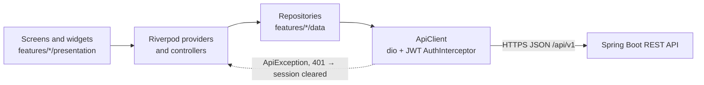
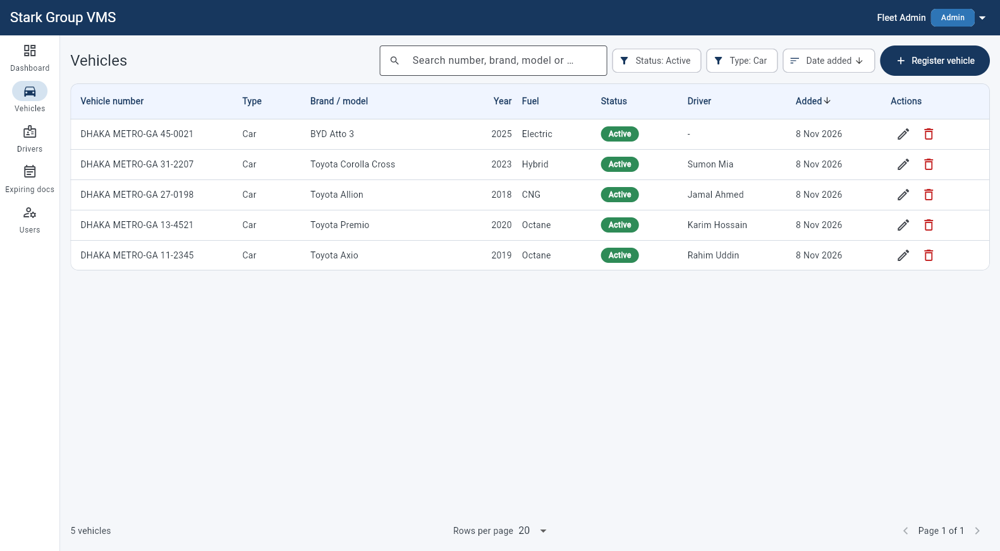
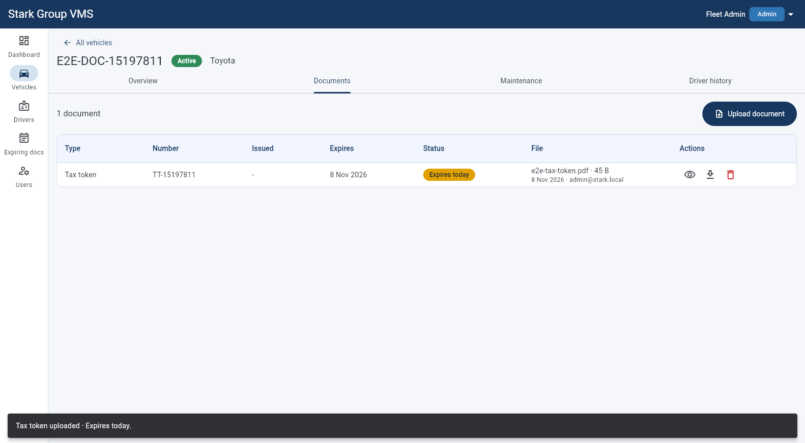
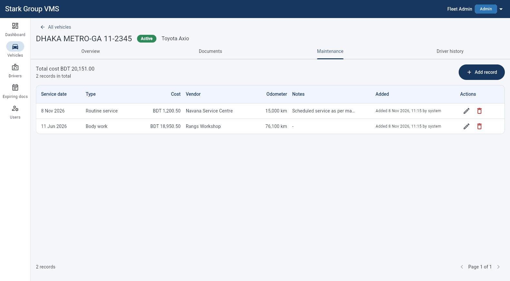
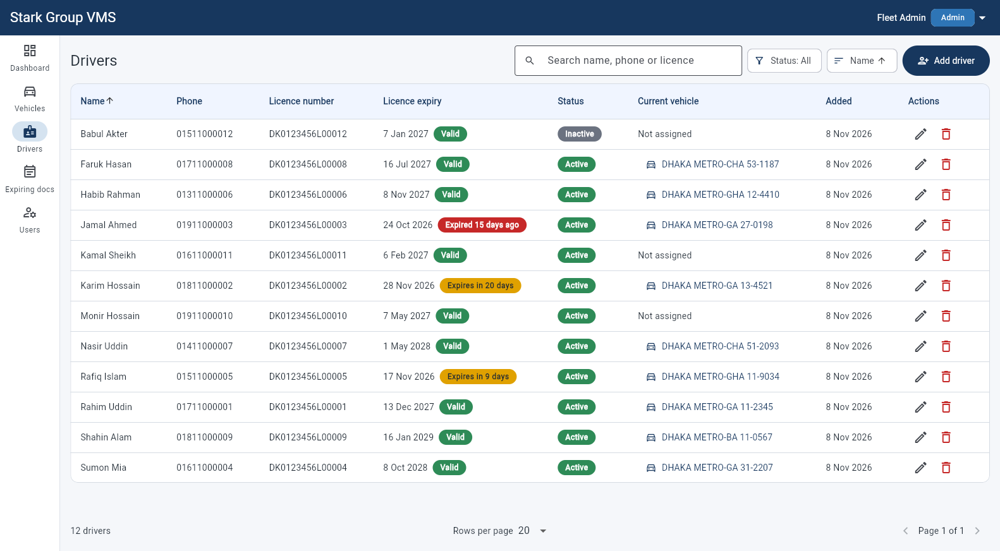
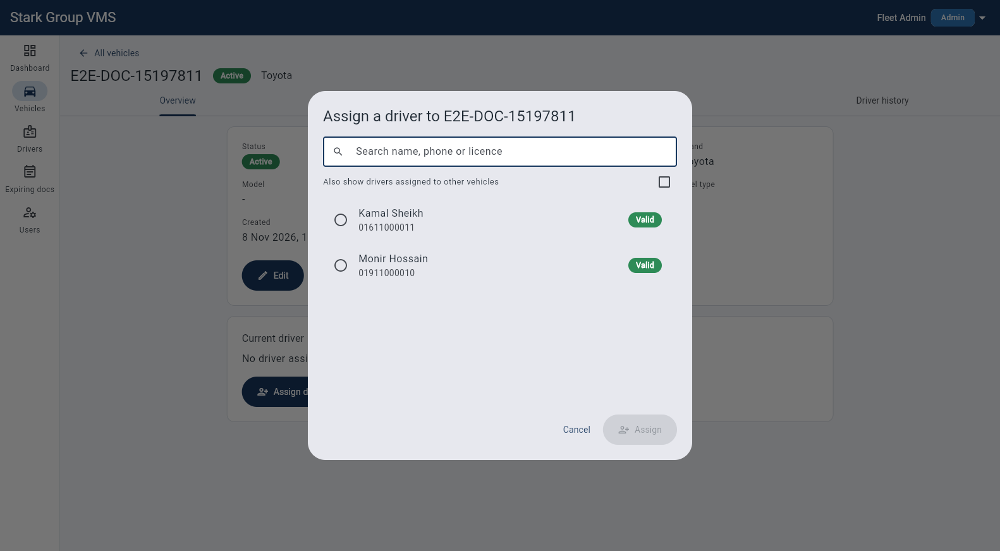
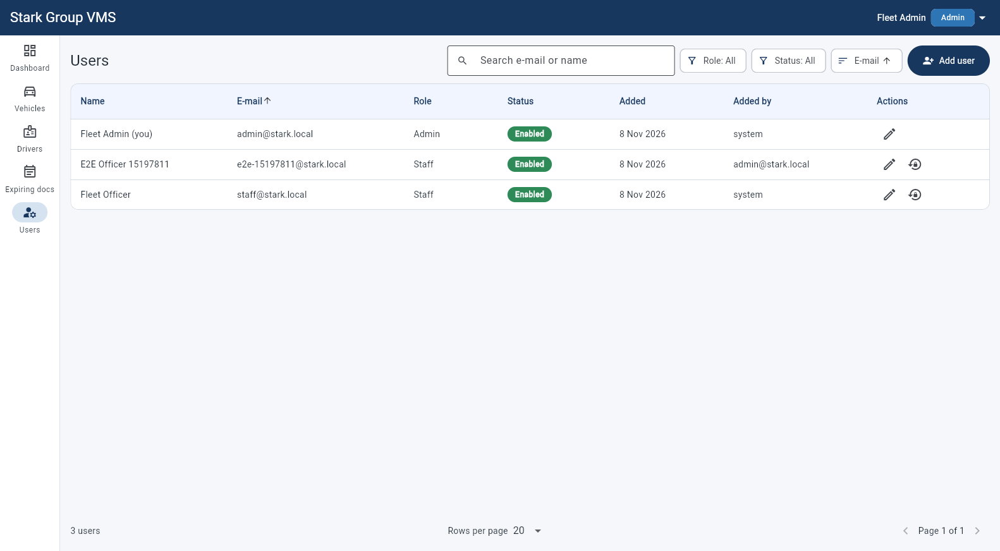

# Stark Group VMS — Frontend (Flutter Web)

Vehicle Management System for the Stark Group fleet. **Release v2.1 (Assignment 2 —
Advanced Fleet Management, hardened)**, built on top of v1.0 (login, vehicle list, register /
edit / delete with duplicate-number protection). v2.0 adds vehicle documents with expiry
tracking, maintenance records, drivers, driver–vehicle assignment, vehicle status management,
server-side search / filters and a summary dashboard. v2.1 adds login throttling (429),
optimistic locking (`version`, "Changed by someone else" dialog), ADMIN user management and
"Change password" for every role.

All data comes from the Spring Boot API ([`stark-vms-backend`](https://github.com/AvishekBis/stark-vms-backend/tree/main), contract in
[`docs/API_CONTRACT.md`](https://github.com/AvishekBis/stark-vms-backend/blob/main/docs/API_CONTRACT.md), Section 6 for v2.0, Section 7 for v2.1) —
there is no mock or hard-coded fleet data in `lib/` (FR-V06); fakes live only in `test/`.

## Live

| | URL |
|---|---|
| Frontend (Netlify) | `https://<your-site>.netlify.app` |
| Backend API (Render) | `https://<your-service>.onrender.com/api/v1` |
| API docs (Swagger UI) | `https://<your-service>.onrender.com/swagger-ui.html` |

Demo accounts (non-real credentials, local/demo profile only):

| Role | Email | Password |
|---|---|---|
| ADMIN | `admin@stark.local` | `Admin@12345` |
| STAFF | `staff@stark.local` | `Staff@12345` |

> The free Render instance sleeps when idle. The first request can take up to a minute; the app
> shows **"Connecting to server…"** after 3 seconds. To give it a head start, the app sends a
> fire-and-forget `GET /actuator/health` as soon as it loads, so the backend wakes while the user
> types the login details. Open the site once before a demo.

## Tech stack (exact versions, pinned in `pubspec.yaml`)

| Area | Package | Version | Since |
|---|---|---|---|
| SDK | Flutter / Dart | 3.47.7 / 3.13.5 | v1.0 |
| State management | `flutter_riverpod` | 2.6.1 | v1.0 |
| Routing | `go_router` | 18.1.2 | v1.0 |
| HTTP (JSON + multipart upload + binary download) | `dio` | 5.11.1 | v1.0 |
| Session storage | `shared_preferences` | 2.5.6 | v1.0 |
| Date/number formatting | `intl` | 0.20.3 | v1.0 |
| **File picking for document upload** | **`file_picker`** | **13.1.0** | **v2.0** |
| **Browser APIs (Blob, object URL, view / download files)** | **`web`** | **1.1.1** | **v2.0** |
| Lints (dev) | `flutter_lints` | 6.0.0 | v1.0 |
| Tests (dev) | `flutter_test`, `integration_test`, `flutter_driver` | SDK | v1.0 |

Notes on the two new packages:

- `file_picker` 13.x has no `withData` flag any more: the picked `PlatformFile` reads its bytes
  on demand. The app checks the size first (`lengthSync()`) and only reads files ≤ 5 MB
  (`readAsBytes()`), then uploads them with `MultipartFile.fromBytes` (file name + content type).
- `web` (not `dart:html`) is used only in `core/platform/file_opener_web.dart`, selected with a
  conditional import, so unit/widget tests on the Dart VM never load browser code.

## Architecture

The reasons for this architecture (bounded contexts, data ownership, layering, state management, security, NFRs) are recorded as Architecture Decision Records in [`../docs/adr/`](https://github.com/AvishekBis/stark-vms-backend/blob/main/docs/adr/README.md).



Screens only watch providers and forward user actions; they never call a repository or build a
request themselves. Providers and controllers hold the state and the rules (validation, which
caches to refresh), and repositories turn domain objects into REST calls through the single
`ApiClient`. The `ApiClient` attaches the bearer token, applies the timeouts and converts every
failure into an `ApiException`, so error handling is the same on every screen.

Feature-first structure (guideline 9.2). Widgets render state and forward user actions; rules
live in controllers, repositories, model getters (e.g. `Vehicle.canReceiveDriver`) and
validators.

```
lib/
├── main.dart, bootstrap.dart, app.dart   entry point, ProviderScope, MaterialApp.router
├── core/
│   ├── config/      AppConfig (API_BASE_URL via --dart-define, timeouts, debounce)
│   ├── network/     ApiClient (Dio + AuthInterceptor; get/post/put/patch/delete,
│   │                postMultipart, getBytes), ApiException (Problem Details),
│   │                PageResponse<T>, FormErrors (server errors → form fields),
│   │                ResponseParsing, SortDirection, SlowRequestMonitor, session signals
│   ├── platform/    FileOpener (Blob + object URL; web impl via package:web, VM stub)
│   ├── router/      go_router with auth guard, query params (?status=, ?tab=, ?withinDays=)
│   ├── storage/     SharedPreferences provider
│   ├── theme/       AppTheme (one ThemeData), AppPalette, StatusColors extension, spacing
│   └── utils/       validators (vehicle, driver, maintenance), formatters (dates, BDT money,
│                    file size), dates, json readers, API enum parsing, debouncer, clock,
│                    ChangeTracker + the shared vehicle / driver change counters
├── shared/
│   ├── models/      ExpiryStatus (BR-08: VALID / EXPIRING_SOON / EXPIRED)
│   └── widgets/     AppShell, StatusBadge, ExpiryBadge, FilterMenu, SortMenu, RowActions,
│                    DataTableFrame, DateFormField, LabeledValue, AsyncValueView/StateViews,
│                    ConfirmDialog, PaginationBar, StaleVersionDialog (v2.1), …
└── features/
    ├── auth/         (v1.0) login, session, AuthController; v2.1: 429 on login,
    │                 ChangePasswordDialog + automatic re-login (PUT /auth/me/password)
    ├── users/        (v2.1, ADMIN) data: UserAccount, UserQuery, UserRepository
    │                 presentation: users list, user form, reset password dialog, providers
    ├── vehicles/     data: Vehicle (+ currentDriver), VehicleQuery (+ status/type filters),
    │                 VehicleRepository (+ PATCH status)
    │                 presentation: list (filters, driver column), detail with tabs, form,
    │                 status dialog, delete flow with BR-10 handling
    ├── drivers/      data: Driver, DriverStatus, DriverQuery, DriverRepository
    │                 presentation: list, form, detail, providers, form controller
    ├── assignments/  data: Assignment, AssignmentRepository (PUT/DELETE /vehicles/{id}/driver,
    │                 histories); presentation: assign dialog, history view, actions
    ├── documents/    data: VehicleDocument, DocumentType, DocumentUploadRules, PickedFile,
    │                 DocumentRepository, DocumentFilePicker
    │                 presentation: Documents tab, upload dialog, expiring documents screen
    ├── maintenance/  data: MaintenanceRecord, MaintenanceType, MaintenanceHistory,
    │                 MaintenanceRepository; presentation: Maintenance tab, add/edit dialog
    └── dashboard/    data: DashboardSummary, DashboardRepository; presentation: dashboard
```

Request flow: screen → Riverpod provider/controller → repository → `ApiClient` → `/api/v1/...`.
The `ApiClient` adds `Authorization: Bearer <token>` (also for file downloads, which is why
documents are fetched as bytes and shown through a Blob URL instead of a plain link), converts
every failure into an `ApiException` (RFC 9457: `status`, `type`, `title`, `detail`,
`errors[] → fieldErrors`) and turns **401 on any request except login** into a redirect to
`/login`.

Every create / update / delete bumps a per-kind change counter (`vehicleChangesProvider`,
`driverChangesProvider`, `documentChangesProvider`, `maintenanceChangesProvider`). Lists, detail
pages and the dashboard watch these counters, so the dashboard numbers always match the data
after a change. The vehicle and driver counters are declared in `core/utils/change_tracker.dart`
because vehicles, drivers and assignments all bump them; the features do not import each
other's providers for that.

## Features and requirements

| ID | Requirement | Where in the UI | Status |
|---|---|---|---|
| FR-AUTH-01 | Login with JWT | `/login` | Done (v1.0) |
| FR-AUTH-02 | Session expiry + logout | auto-logout, 401 → login | Done (v1.0) |
| FR-V01 | Vehicle list (loading / empty / error) | `/vehicles` | Done (v1.0) |
| FR-V02 | Register vehicle | `/vehicles/new` | Done (v1.0) |
| FR-V03 | Edit vehicle | `/vehicles/:id/edit` | Done (v1.0) |
| FR-V04 | Delete vehicle (ADMIN, confirm) | list + detail; BR-10 409 → "Set INACTIVE instead" | Done (extended in v2.0) |
| FR-V05 | Duplicate number on the right field | vehicle form | Done (v1.0) |
| FR-V06 | Real data only | whole app | Done |
| **FR-D01** | Document upload (6 types, PDF/JPG/PNG ≤ 5 MB, number, issue/expiry dates), view / download | vehicle detail → Documents tab, upload dialog | Done |
| **FR-D02** | Expiry tracking (VALID / EXPIRING_SOON ≤ 30 d / EXPIRED, colour + text) | `ExpiryBadge` in Documents tab, `/documents/expiring`, dashboard | Done |
| **FR-M01** | Maintenance records (date, type, cost BDT, vendor, odometer, notes), edit, delete (ADMIN) | Maintenance tab + dialog | Done |
| **FR-M02** | Maintenance history newest first, total cost, paginated | Maintenance tab | Done |
| **FR-V07** | Vehicle status ACTIVE / INACTIVE / MAINTENANCE via a dedicated action | "Change status" (ADMIN) on vehicle detail; badges in list + detail | Done |
| **FR-V08** | Server search: number, brand, model, current driver | vehicle list search (350 ms debounce) | Done |
| **FR-V09** | Server filter (status, type), sort, pagination, total count | vehicle list filters, sort, pagination; filter change → page 0 | Done |
| **FR-DR01** | Driver CRUD, unique phone / licence | `/drivers`, `/drivers/new`, `/drivers/:id`, `/drivers/:id/edit` | Done |
| **FR-DR02** | Assign / change / unassign driver, history kept | vehicle Overview driver card, assign dialog, Driver history tab, driver detail | Done |
| **FR-DB01** | Dashboard: vehicle counts, documents expired / expiring, maintenance count + cost this month | `/dashboard` (one `GET /dashboard/summary`) | Done |
| **FR-X01** | Audit fields createdAt / updatedAt / createdBy | vehicle, driver, document, maintenance, assignment views | Done |
| **FR-X02** | Driver licence expiry on dashboard | dashboard "Driver licences expiring", licence badges on drivers | Done |
| **v2.1 · ADR 0022** | Login throttling: 429 + `Retry-After` after 5 failures per e-mail / 20 per IP | login screen shows the server `detail` ("Try again in N minutes."), never "Invalid email or password."; a 429 never ends a session | Done |
| **v2.1 · ADR 0023** | Optimistic locking: `version` on vehicles, drivers, maintenance records, users | edit forms send the loaded `version`; 409 `stale-version` → "Changed by someone else" dialog (Reload / Cancel); also the driver "Set INACTIVE instead" action | Done |
| **v2.1 · ADR 0024** | ADMIN user management (list, create, edit, disable, reset password), no delete | "Users" nav item (ADMIN only), `/users`, `/users/new`, `/users/:id/edit` | Done |
| **v2.1 · ADR 0024** | Change own password (any role) | user menu → "Change password"; logs in again with the new password automatically | Done |

Business rules reflected in the UI (the server is the authority):

| Rule | Frontend behaviour |
|---|---|
| BR-05 | "Assign driver" is disabled for non-ACTIVE vehicles; the dialog lists only ACTIVE drivers (`available=true`); the status dialog warns that INACTIVE unassigns the driver |
| BR-06 | 409 `driver-already-assigned` (TC-10) and `assignment-not-allowed` are shown inside the assign dialog with the server's detail |
| BR-07 | Upload dialog checks extension (PDF/JPG/JPEG/PNG), size ≤ 5 MB, expiry ≥ issue before sending; server 400 `errors[]` and 413 are shown under the right field |
| BR-08 | `ExpiryStatus` + `ExpiryBadge` ("Expires in 12 days", "Expired 3 days ago"); the server value is used, the rule is mirrored only as a fallback |
| BR-09 | Maintenance cost ≥ 0 with ≤ 2 decimals; service date picker cannot go past today |
| BR-10 | Deleting a vehicle with history shows the 409 detail and offers "Set INACTIVE instead" (ADMIN); drivers with history likewise |

## Screens

| Screen | Route | What it does |
|---|---|---|
| Login | `/login` | Email + password, generic 401 message, session-expired notice; v2.1: a 429 shows the server's "Too many failed login attempts. Try again in N minutes." |
| Dashboard | `/dashboard` | Cards: total / active / under maintenance / inactive vehicles (tap → filtered vehicle list), documents expired / expiring (tap → expiring screen), maintenance this month (count + BDT cost), drivers (total / active / assigned, licences expired / expiring). Lists: top-10 expiring documents (tap → vehicle Documents tab) and expiring driver licences. Refresh button + pull to refresh. Responsive 1 / 2 / 4-column grid |
| Vehicle list | `/vehicles`, `/vehicles?status=MAINTENANCE&type=BUS` | Search "number, brand, model or driver", Status and Type filter chips, sort menu + sortable columns, pagination (10/20/50/100), driver column (table) / driver line (cards). Filters, search, sort and page survive navigation |
| Register / edit vehicle | `/vehicles/new`, `/vehicles/:id/edit` | v1.0 form |
| Vehicle detail | `/vehicles/:id?tab=overview\|documents\|maintenance\|drivers` | Tabs **Overview** (all fields, status badge, Edit, ADMIN Change status + Delete, current driver card with Assign / Change / Unassign) · **Documents** · **Maintenance** · **Driver history** (paginated, current highlighted) |
| Expiring documents | `/documents/expiring?withinDays=30` | Fleet-wide expired + expiring documents, 7 / 30 / 60 / 90-day window, paginated, tap → vehicle Documents tab (nav item "Expiring docs") |
| Drivers | `/drivers` | Debounced search (name, phone, licence), status filter, sortable Name / Licence expiry / Date added, pagination, licence badge, current vehicle link, cards < 600 px |
| Add / edit driver | `/drivers/new`, `/drivers/:id/edit` | Name, BD mobile phone (normalized, `^0\d{10}$`), licence number, licence expiry date picker, status; server 409 duplicate phone / licence under the right field |
| Driver detail | `/drivers/:id` | Info with audit fields, current vehicle link, Edit, ADMIN Delete, assignment history |
| Users (v2.1, ADMIN) | `/users` | Debounced search (e-mail or name), Role and Status filters, sort E-mail / Name / Date added (default e-mail ascending), pagination, "Enabled" / "Disabled" text + colour badge, row actions Edit and Reset password (hidden on the own row, marked "(you)"). STAFF opening `/users…` is sent to the dashboard (the backend 403 is the real control) |
| Add / edit user (v2.1, ADMIN) | `/users/new`, `/users/:id/edit` | Create: e-mail (sent trimmed + lower-case), full name, role, password + repeat (8 characters to 72 bytes UTF-8). Edit: e-mail read-only, name, role, "Account enabled" switch; disabling asks for confirmation; on the own account role and enabled are locked. 409 `duplicate-email` under the e-mail field, `self-modification` / `last-admin` as a message |
| Reset password (v2.1, ADMIN) | dialog from the users list | New password + repeat; the user's open sessions end on their next request |
| Change password (v2.1, every role) | dialog from the user menu | Current + new + repeat; a wrong current password (400) is shown under that field and keeps the session; after too many wrong current passwords the server's 429 message ("Too many failed login attempts. Try again in N minutes.") is shown in the dialog, also without ending the session; after the 204 the app logs in again with the new password ("Password changed."), or, if that fails, opens the login screen with "Your password was changed. Please log in with the new password." |

**Optimistic locking (v2.1, ADR 0023).** Vehicle, driver, maintenance and user edit forms keep
the `version` of the record they loaded and send it in the `PUT` (create requests never send
it). When someone else changed the record meanwhile, the server answers 409 `stale-version`
and the app shows **"Changed by someone else"** with the server's detail and "Reloading
replaces your unsaved changes.": **Reload** fetches the record again and refills the form
("Reloaded the latest version. Your unsaved changes were discarded."), **Cancel** keeps the
edits on screen. Server-side changes (status change, deactivation, disabling, password reset)
also bump the version, so a form opened before them gets the dialog too — intended. A response
without `version` (an older backend) is read as `version: 0`.

Every async view handles loading, data, empty and error (with Retry). Destructive actions
(delete vehicle / driver / document / maintenance record, unassign) always ask for
confirmation. Badges always show text next to the colour. Layout: cards < 600 px, compact
table 600–1024 px, full table > 1024 px — for the vehicle and driver lists and also for the
Documents and Maintenance tabs, the expiring documents screen and both assignment histories.

### Screenshots

Taken by the E2E journey below (`binding.takeScreenshot`, saved by
`test_driver/integration_test.dart`) against the local backend with its seeded demo data.

| Login | Dashboard summary |
|---|---|
|  |  |
| **Vehicle list with Status and Type filters** | **Documents tab with expiry badge** |
|  |  |
| **Maintenance tab with total cost** | **Drivers list** |
|  |  |
| **Assign driver dialog** | **Users list (v2.1, ADMIN)** |
|  |  |

## Run locally

Prerequisites: Flutter 3.47.7, Chrome, and the backend running on `http://localhost:8080`
(see the backend README). The backend must allow the dev origin, e.g.
`CORS_ALLOWED_ORIGINS=http://localhost:5000`, and expose `Content-Disposition` (contract 6.5).

```bash
flutter pub get
flutter run -d chrome --web-port 5000 --dart-define=API_BASE_URL=http://localhost:8080/api/v1
```

| `--dart-define` | Default | Purpose |
|---|---|---|
| `API_BASE_URL` | none (required) | API base URL incl. `/api/v1`. No hard-coded fallback: a build without it shows an "API address not configured" screen |
| `SHOW_DEMO_CREDENTIALS` | `true` in debug / profile, `false` in release | Show the demo account hint on the login screen. Pass `true` explicitly for a demo release build; production builds should leave it off |

## Build and deploy to Netlify

```bash
flutter build web --release --dart-define=API_BASE_URL=https://<your-service>.onrender.com/api/v1
# Course demo only: also show the demo account hint on the login screen.
#   --dart-define=SHOW_DEMO_CREDENTIALS=true
```

1. Deploy the `build/web` folder: drag-and-drop in the Netlify UI, or
   `npx netlify-cli deploy --prod --dir=build/web`.
2. SPA routing: `web/_redirects` (`/*  /index.html  200`) is copied into `build/web`, and
   `netlify.toml` contains the same rule, so deep links such as `/vehicles/12?tab=documents`
   survive a refresh. `web/_headers` and `netlify.toml` also set the security headers (see
   "Security notes").
3. Add the Netlify URL to the backend's `CORS_ALLOWED_ORIGINS` on Render and redeploy it.
4. Smoke-test on the live URL: login, dashboard numbers, vehicle filters, upload a document,
   assign a driver.

CI (`.github/workflows/ci.yml`) runs on every push to any branch and on every pull request:
`flutter pub get` → `dart format --set-exit-if-changed` → `flutter analyze` → `flutter test` →
`flutter build web --release` with the repository variables `API_BASE_URL` and
`SHOW_DEMO_CREDENTIALS` (default `false`).

## Decisions and trade-offs

This is a short summary. Each decision, with the alternatives considered and its consequences, is an ADR in [`../docs/adr/`](https://github.com/AvishekBis/stark-vms-backend/blob/main/docs/adr/README.md).

- **Riverpod (`flutter_riverpod` 2.6.1)** for state: compile-time safe providers, easy fakes in
  tests (`overrideWithValue`) and `AsyncValue` for loading / data / error without boilerplate.
  Trade-off: one more concept to learn than `setState`, but no global singletons.
- **go_router** for routing: URL-based routes (deep links and browser refresh work on the web),
  one redirect guard for authentication, query parameters for filters.
- **dio** for HTTP: interceptors (JWT, 401 handling), timeouts and typed errors in one place.
  Trade-off: a larger dependency than `package:http`.
- **Responsive breakpoints (guideline 14.2).** Cards below 600 px, a compact table from 600 to
  1024 px, the full table above. Wide tables scroll sideways instead of squeezing columns.
- **Debounced search (350 ms).** The search box asks the server only after the user pauses
  typing; Enter searches at once. Fewer requests, still responsive.
- **Change counters instead of manual refreshes.** Every create / update / delete bumps a
  per-kind counter (`vehicleChangesProvider`, `driverChangesProvider`, …); lists, detail pages
  and the dashboard watch them, so one bump refreshes everything that shows that data. The
  vehicle and driver counters live in `core/utils/change_tracker.dart` because several
  features bump them.
- **Token storage.** The JWT is kept in `localStorage` (via `shared_preferences`) so a reload
  keeps the session; the XSS trade-off and its mitigations are described under
  "Security notes and trade-offs".
- **Demo credentials hint** is shown only in debug / profile builds, or in a release build made
  with `--dart-define=SHOW_DEMO_CREDENTIALS=true` for a course demo.

## Security notes and trade-offs

- **Token storage (XSS trade-off).** The JWT is kept in browser storage (`shared_preferences`
  → `localStorage`) so a reload keeps the user logged in. Any script on the page could read it.
  Acceptable for the course (60-minute token, no user-supplied HTML, cleared on logout / expiry /
  401); production would prefer an `HttpOnly` refresh cookie plus an in-memory access token.
- Document files are never linked directly: they are downloaded with the bearer token and shown
  through a short-lived Blob object URL (revoked after one minute).
- Hiding Delete / Change status for STAFF is a convenience only; the backend enforces roles (403).
  The same holds for the v2.1 "Users" item and the `/users` redirect for STAFF.
- **v2.1 token checks.** The backend loads the user on every request and rejects the token
  (401) when the user was disabled or the password changed after the token was issued; the
  effective role is the current one in the database. The app therefore signs a disabled user
  out on their next request. Right after an own password change the old token is invalid, so
  a 401 from a request that was still in flight is ignored until the automatic re-login has
  finished (otherwise the user would briefly see "session expired").
- **Throttled login (429)** is shown as a form error and never treated like a 401. Passwords
  are checked client-side like on the server (8 characters, counted as Unicode code points, to
  72 bytes in UTF-8); the "repeat password" fields never leave the browser.
- The redirect after login only accepts in-app paths (no open redirect).
- The demo account hint is not compiled into release builds unless
  `SHOW_DEMO_CREDENTIALS=true` is passed; `.gitignore` excludes `.env*`, `*.pem`, `*.key`,
  `*.jks`, `*.keystore`, `*.p12` and `key.properties`.
- **Security headers.** `netlify.toml` (and `web/_headers`, copied into `build/web` for a
  drag-and-drop deploy) send `X-Frame-Options: DENY`, `Content-Security-Policy:
  frame-ancestors 'none'` (no clickjacking), `X-Content-Type-Options: nosniff` and
  `Referrer-Policy: strict-origin-when-cross-origin`. A full script / connect CSP is a next step:
  Flutter's inline loader script in `web/index.html` needs a hash, and `connect-src` needs the
  per-deployment API URL.

## Tests

```bash
flutter test                  # unit + widget tests (315, including the v1.0 and v2.0 regression tests)
dart format --output=none --set-exit-if-changed .
flutter analyze
```

Last run (v2.1 with the security-review fixes, 2026-11-08): 315 tests passed, `flutter analyze` 0 issues, `dart format` 0 changed. Saved output of `flutter test --reporter expanded`:
[`../docs/test-reports/frontend-test-report.txt`](docs/test-reports/frontend-test-report.txt).

| Level | File | Covers |
|---|---|---|
| Unit | `test/unit/vehicle_model_test.dart`, `auth_models_test.dart`, `page_response_test.dart`, `api_exception_test.dart`, `validators_test.dart`, `vehicle_query_test.dart`, `auth_redirect_test.dart`, `auth_controller_test.dart`, `api_client_test.dart` | v1.0 (unchanged, regression) |
| Unit | `test/unit/expiry_status_test.dart` | ExpiryStatus parsing, BR-08 boundaries (TC-08, TC-09), badge texts, tones |
| Unit | `test/unit/driver_model_test.dart` | Driver JSON (current vehicle, nulls), DriverInput normalization, DriverQuery params |
| Unit | `test/unit/document_model_test.dart` | Document JSON, upload rules (size, extension, expiry < issue), multipart parts, Content-Disposition |
| Unit | `test/unit/maintenance_and_assignment_test.dart` | MaintenanceHistory (totalCost, recordCount), record + input, Assignment JSON |
| Unit | `test/unit/dashboard_summary_test.dart` | DashboardSummary incl. nulls / empty lists |
| Unit | `test/unit/validators_v2_test.dart` | Phone validator / normalizer, maintenance cost / date / odometer, BDT money + file size formatters, FormErrors mapping |
| Unit | `test/unit/vehicle_v2_test.dart` | currentDriver parsing, status/type params, filter change → page 0, URL parsing |
| Widget | v1.0 files (`login_screen`, `vehicle_list_screen`, `vehicle_form_screen`, `vehicle_detail_screen`, `status_badge`, `state_views`, `missing_configuration`) | Regression, unchanged |
| Unit | `test/unit/driver_actions_test.dart` | `DriverActions.deactivate` (same fields + INACTIVE, refreshes drivers and vehicles), `hasHistory` |
| Unit | `test/unit/model_rules_test.dart` | `Vehicle.canReceiveDriver` (BR-05), `endsAssignmentOn`, `Driver.losesVehicleOn`, API enum parsing |
| Unit | `test/unit/app_config_test.dart` | Demo credentials hint follows the build mode by default |
| Unit | `test/unit/business_date_test.dart` | "Today" in Asia/Dhaka (UTC+6) for BR-08/BR-09, expiring-docs link → first page |
| Widget | `test/widget/responsive_v2_test.dart` | No overflow at 360 / 800 / 1400 px inside the app shell: dashboard, all four vehicle-detail tabs, drivers, users list and user form (v2.1), expiring documents; assign / status / upload / maintenance dialogs on a 360 x 640 phone |
| Widget | `test/widget/responsive_lists_test.dart` | Maintenance tab, expiring documents and assignment history: cards at 360 px, compact table at 800 px, full table at 1400 px; rows open the right page |
| Widget | `test/widget/sort_menu_test.dart` | Sort chip / menu show arrow icons (no '↑'/'↓' glyphs), `RowActions` keys |
| Widget | `test/widget/expiry_badge_test.dart` | Text + colour for each expiry status |
| Widget | `test/widget/dashboard_screen_test.dart` | Numbers from a fake repository, card taps → filtered routes, error + Retry, phone layout |
| Widget | `test/widget/vehicle_list_filters_test.dart` | status / type / search params sent to a fake repo, page reset, driver column / card line, `?status=` from the URL |
| Widget | `test/widget/assign_driver_dialog_test.dart` | available=true query, assign, **409 TC-10 detail shown** |
| Widget | `test/widget/documents_tab_test.dart` | Sorted with badges, **Delete hidden for STAFF**, ADMIN delete confirm, upload client checks, 413 under file |
| Widget | `test/widget/maintenance_tab_test.dart` | **Total cost** + record count, STAFF/ADMIN actions, dialog validation, empty state |
| Widget | `test/widget/driver_screens_test.dart` | Drivers list (badges, search / filter / sort params), **duplicate phone under the phone field**, duplicate licence, driver detail history |
| Widget | `test/widget/vehicle_detail_v2_test.dart` | Four tabs, `?tab=documents`, driver history highlight, unassign confirm, status change with INACTIVE warning, BR-10 "Set INACTIVE instead" |
| Unit | `test/unit/login_throttling_test.dart` | v2.1: 429 Problem Details keeps the `detail`, is not a 401, never fires the 401 → login signal, login controller shows the detail instead of "Invalid email or password." |
| Unit | `test/unit/optimistic_locking_test.dart` | v2.1: `version` parsed (missing → 0), sent in every update body and never in create bodies, repositories' PUT/POST bodies, `isStaleVersion`, `FormSubmitState.failed` keeps stale apart, vehicle / driver / maintenance controllers and `DriverActions.deactivate` send the loaded version |
| Unit | `test/unit/user_management_test.dart` | v2.1: `UserAccount` JSON, create / update bodies (e-mail lower-cased, never in PUT, `version`), `UserQuery` params and page reset, password policy (8 code points … 72 UTF-8 bytes), repository paths and methods, duplicate-email / last-admin / self-modification / stale mapping, `/users` guard for STAFF, change password with re-login, failed re-login, 401 ignored during re-login, 400 keeps the session |
| Widget | `test/widget/stale_version_test.dart` | v2.1: vehicle form (Cancel keeps edits, Reload refills, next save sends the new version), driver form, maintenance dialog |
| Widget | `test/widget/users_screens_test.dart` | v2.1: users table with text badges, no reset on the own row, compact table / cards, debounced search, role and status filters, error + Retry, reset password dialog, create form, 409 duplicate e-mail under the field, edit form (e-mail read-only, disable confirmation, own account locked, last-admin message, stale Reload) |
| Widget | `test/widget/app_shell_v21_test.dart` | v2.1: "Users" only for ADMIN (rail and drawer), change password from the user menu (stays logged in), wrong current password under its field, 429 after too many wrong current passwords shown in the dialog without a sign-out (security review), client-side checks |
| Widget | `test/widget/login_screen_test.dart` (extended) | v2.1: 429 detail shown, not "invalid credentials" |
| E2E | `integration_test/app_journey_test.dart` | v1.0 journey + **upload document → `ExpiryBadge` "Expires today" in the Documents tab → dashboard counts it and lists it with the same badge** → BR-10 delete blocked → cleanup |

### End-to-end journey (needs a running v2.0 backend)

The E2E test drives the real app in Chrome against a real API, so it is not part of CI.

1. Start the backend locally with its embedded PostgreSQL, local profile, demo ADMIN account
   and seeded data: `cd ../stark-vms-backend && mvn spring-boot:test-run`. The local profile
   allows any `http://localhost:<port>` origin, so no CORS setting is needed. Wait until
   `http://localhost:8080/actuator/health` reports `UP`.
2. Download a ChromeDriver matching your Chrome version
   (<https://googlechromelabs.github.io/chrome-for-testing/>) and start it:
   `chromedriver --port=4444`
3. Run:

```bash
flutter drive \
  --driver=test_driver/integration_test.dart \
  --target=integration_test/app_journey_test.dart \
  -d web-server --browser-name=chrome --driver-port=4444 \
  --dart-define=API_BASE_URL=http://localhost:8080/api/v1
```

`-d web-server` makes `flutter drive` open Chrome through the ChromeDriver on port 4444; with
`-d chrome` it can wait forever for a debug connection. The journey also writes the
screenshots above to `docs/screenshots/`.

Optional: `--dart-define=E2E_EMAIL=... --dart-define=E2E_PASSWORD=...`.

What it does:

1. **v1.0**: login → register `E2E-<timestamp>` → the same number in another format is blocked
   (409 under the field) → find it with the server search → edit → delete (204).
2. **v2.0**: read the dashboard's expired + expiring document counts → register
   `E2E-DOC-<timestamp>` → Documents tab → upload a Tax token that expires today (the browser
   file dialog cannot be automated, so the test injects a tiny generated PDF through
   `bootstrap(overrides: …)` — everything else, including the multipart upload, is real) →
   the **`ExpiryBadge`** with "Expires today" is visible in the Documents tab → the
   **dashboard** count went up by one and its "Expiring documents" list shows the vehicle with
   the same badge → the expiring documents screen lists it → deleting the vehicle is refused with the BR-10
   dialog (after opening the **assign driver** dialog and cancelling it) → delete the document
   (ADMIN) → delete the vehicle.
3. **Read-only tour** for the screenshots: drivers list → vehicle list filtered to Active cars →
   the seeded `DHAKA METRO-GA 11-2345` → Maintenance tab (total cost).
4. **v2.1**: the edit in step 1 already sends the loaded `version` (ADR 0023; a 200 proves the
   round-trip) → **Users** (ADMIN) → add a STAFF user `e2e-<timestamp>@stark.local` → it is in
   the list (screenshot `users_list`) and found by the server search as "Enabled" → open it,
   switch "Account enabled" off, confirm "Disable user" (the PUT sends the user's `version`) →
   the list shows "Disabled". Users cannot be deleted, so the journey leaves this one disabled
   (the `spring-boot:test-run` database is recreated on every start).

Last run: 2026-11-08, Chrome via ChromeDriver against `./mvnw spring-boot:test-run` — all
steps passed.

## Known limitations / next steps

- No refresh token: the user logs in again after 60 minutes.
- The role shown in the app (and the "Users" item) comes from the login response and is
  refreshed from `GET /auth/me` on every page load. A demoted ADMIN keeps seeing "Users" until
  the next reload, but the backend answers 403 at once (contract 7.3.5).
- Login throttling state lives in the backend's memory (one instance, reset by a restart).
  Wrong current passwords on "Change password" count towards the same per-e-mail limit
  (security review, ADR 0022 Amendment), so an e-mail locked by failed logins also blocks
  "Change password" for up to 15 minutes.
- The maintenance service date and document dates use the browser's calendar date; the server
  decides "today" in Asia/Dhaka, so around midnight in another time zone the server may reject a
  date the picker allowed (its error is shown under the field).
- The E2E journey is not part of CI: it needs a running backend and a matching ChromeDriver.
